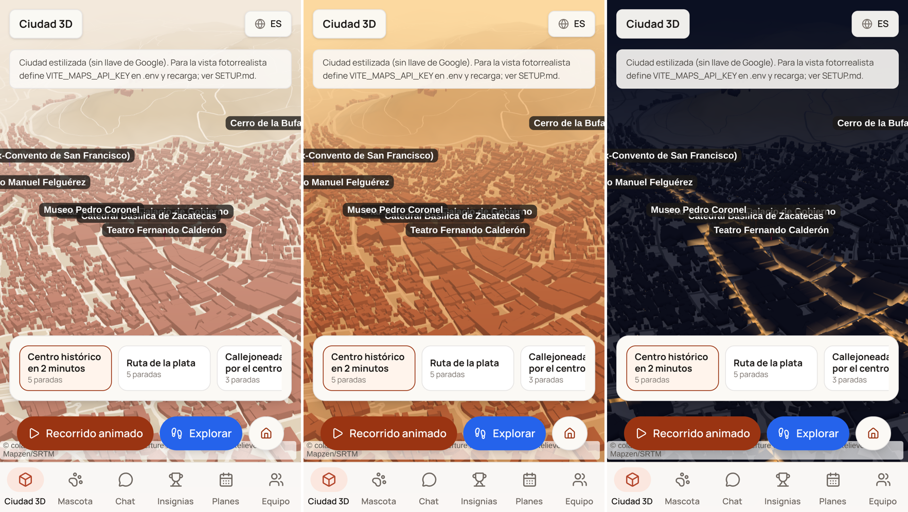
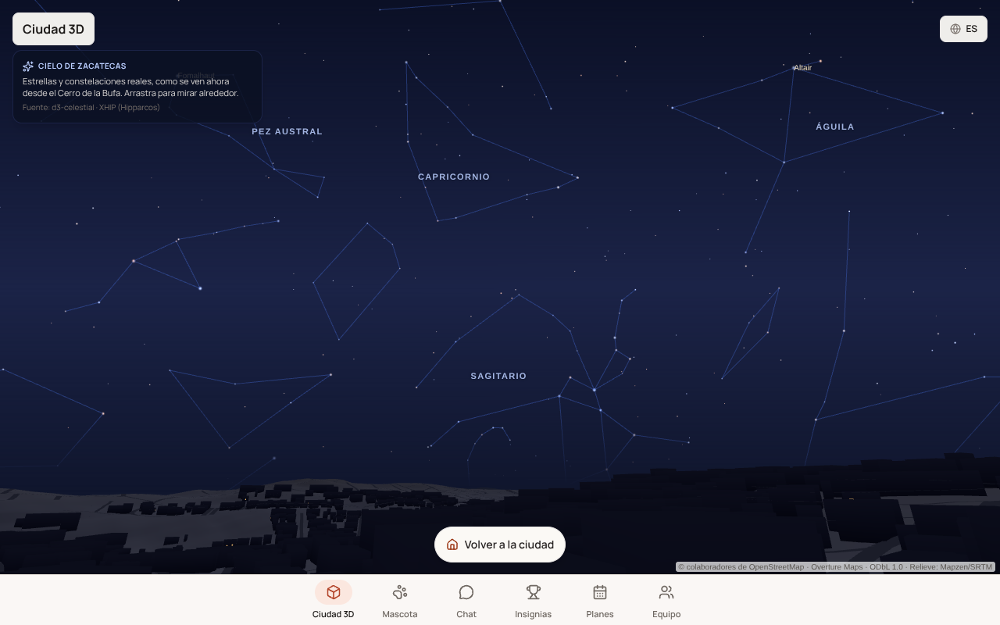

# Ciudad 3D estilo juego — arquitectura

Objetivo: un recorrido 3D animado sobre la arquitectura real de Zacatecas, con mecánicas tipo Pokémon Go (avatar, descubrir lugares, colección), donde sea fácil enchufar recomendaciones, fotos, avatares y animaciones. Web app primero (navegador móvil); app nativa después, si el demo lo justifica.

Ábrelo en `http://localhost:3000/#3d` (o con el botón **Ciudad 3D** del encabezado). Con `VITE_MAPS_API_KEY` (Maps JavaScript API) se ve fotorrealista; sin llave, estilizada.

## Capas

```
 UI (React)                 src/components/Map3DView.tsx   tarjetas, HUD, botones
   │ usa
 Contrato                   src/types/scene3d.ts           SceneEngine · SceneLayer · ScenePoi · Tour
   │ implementan
 Motor 3D                   src/scene3d/googleMaps3dEngine.ts   (mañana: cesiumEngine.ts, threeEngine.ts)
 Capas de contenido         src/scene3d/layers/*.ts        lugares, fotos, recomendaciones, retos
   │ leen
 Datos                      src/data/*.ts (mock) · /api/py/* (FastAPI, services/api)
```

- **Motor (`SceneEngine`)**: monta la escena, pinta puntos, mueve la cámara (`flyTo`, `orbit`), dibuja rutas. La UI nunca habla con Google/Cesium/Three directamente, así que cambiar de motor es escribir otra clase con la misma interfaz.
- **Capa (`SceneLayer`)**: una función `load()` que devuelve `ScenePoi[]`. Es el punto de enchufe para todo lo nuevo. Una capa puede leer `src/data/` o llamar a `/api/py/...`.
- **Recorrido (`Tour`)**: lista de paradas con cámara, pausa y subtítulo es/en. Hoy en `src/data/tours3d.ts`; luego desde `GET /api/py/tours`.

## Motor elegido para el primer mock

**Google Maps 3D** (`Map3DElement` de Maps JavaScript API, librería `maps3d`): muestra los Photorealistic 3D Tiles de la ciudad real, usa la misma llave que el mapa 2D y ya trae marcadores 3D, polilíneas, vuelos de cámara y modelos `.glb` (`Model3DElement`).

Desde #127 la vista abre por defecto en la ciudad estilizada de three.js, haya o no llave: es la vista normal, no un respaldo. Google Maps 3D se elige a mano con `?engine=google#3d` y Cesium con `?engine=cesium#3d`; las dos necesitan llave.

Límites conocidos, que abren issues:
- `Model3DElement` no reproduce animaciones glTF. Para el avatar que camina está **CesiumJS** (`src/scene3d/cesiumEngine.ts`, mismos 3D Tiles vía Map Tiles API): `?engine=cesium#3d`. Comparativa en `docs/poc/motor-3d.md`; `?stats=1` muestra tiempos y fps.
- Si Google rechaza la llave (dominio no autorizado, API sin habilitar) o no hay 3D Tiles, la vista cae sola a three.js y muestra el código de error de Google.
- Cuesta por carga de mapa y necesita red. **Sin llave** (o con `?engine=three`) entra `src/scene3d/threeOsmEngine.ts`: ciudad estilizada con three.js y 6,861 huellas reales de edificios (`public/data/centro-edificios.json`, Overture Maps 2026-10-21: OpenStreetMap + Microsoft + Google Open Buildings, ODbL). Relieve real de AWS Terrain Tiles (SRTM, cuadrícula de 10 m; `scripts/gen-terrain.py` → `public/data/centro-terreno.*`), calles de OpenStreetMap vía Overture (`public/data/centro-calles.json`) y alturas estimadas por tamaño de huella. El fondo sigue la hora de Zacatecas sin interruptor (#128): día, tarde (17:30–19:30) y noche (19:30–06:30), ventana fija `PROTO:` en `src/scene3d/timeOfDay.ts`; cambia sola al cruzar un corte. Para probar: `?hora=dia` (o `tarde`, `noche`; `?noche=1` también vale).  De noche la ciudad queda oscura y solo se alumbran las calles principales del centro (#136): la lista y su traza salen de OpenStreetMap por nombre (`scripts/gen-alumbrado.py` → `public/data/centro-alumbrado.json`); para cambiarla, edita `CALLES` en el script y vuelve a correrlo. De noche también sale el cielo real (#197): estrellas hasta magnitud 5.5 y las líneas de las constelaciones, giradas con la hora sideral de Zacatecas (`src/scene3d/starSky.ts`; datos de d3-celestial, BSD-3, estrellas de XHIP/Hipparcos: `scripts/gen-cielo.py` → `public/data/cielo.json`). «Mirar el cielo» sube la cámara al Cerro de la Bufa, mira al suroeste y deja girar la vista arrastrando; muestra los nombres de las constelaciones principales y de las estrellas más brillantes. Si no es de noche en Zacatecas (p. ej. con `?hora=noche`), enseña el cielo de hoy a las 22:00. 
- Licencia: los 3D Tiles de Google no se pueden cachear ni extraer; se muestran en vivo con atribución.

## Cómo agregar algo nuevo

**Una capa** (fotos, recomendaciones, retos):
1. Crea `src/scene3d/layers/miCapa.ts` que exporte un `SceneLayer`.
2. Devuelve `ScenePoi` con `kind` adecuado y `isMock: true` si los datos son de ejemplo.
3. Regístrala en `src/scene3d/layers/index.ts`. Con `toggleable: true` sale un interruptor en el HUD de Explorar; `load(context)` recibe la posición del jugador y los lugares visitados, y `reloadOnDiscover: true` la recarga al descubrir un lugar (así funciona `recommendationsLayer`).
4. Si los datos vienen de Python: endpoint en `services/api/` + fixture en `services/api/app/fixtures/` + contrato en `docs/API.md`.

**Un recorrido**: agrega un `Tour` en `src/data/tours3d.ts` usando `placeId` de `src/data/places.ts`. Los subtítulos deben salir de datos documentados (descripciones de `places.ts` o fuentes de la base de conocimientos), nunca inventados.

**Una temporada o fiesta** (#68): agrégala en `src/data/seasons.ts` con `provisional: true` y su fuente por confirmar. `activeSeason(fecha)` la activa; sus banderas (`night`, `petals`, `fireworks`, `papelPicado`, `legendaryDrops`) deciden qué pinta la vista: la noche y los pétalos van en el motor (`setSeason`, opcional), el papel picado y los cohetes en `src/scene3d/SeasonOverlay.tsx`. Un recorrido con `season` solo se ofrece en esa temporada. Un evento de un solo año lleva `year` y `provisional: false` con `sourceUrl` oficial (p. ej. la Carrera Panamericana del 22 de oct de 2026, datos en `src/data/panamericana.ts`). Para probar: `?temporada=muertos` (o `feria`, `panamericana`, `ninguna`).

**Un avatar**: modelo `.glb` low-poly (< 2 MB, solo PBR básico, sin extensiones glTF), con licencia libre anotada, en `public/models/avatars/`.

**Un motor**: clase nueva que implemente `SceneEngine`, elegida en `Map3DView` (p. ej. por `?engine=cesium`).

## Mecánicas de juego (plan)

1. Recorrido animado de cámara (hecho en el mock).
2. Avatar en la escena, movido con teclado o pad táctil (hecho: `minero.glb` generado por `scripts/gen-avatar-glb.mjs`, `useAvatarControls`; sin animación de caminar hasta decidir motor).
3. Posición por GPS, con modo simulado para probar desde casa (hecho: `usePlayerPosition`, `?sim=1#3d` lo fuerza; tocar el mapa mueve al jugador a mano).
4. Descubrir lugares al entrar en un radio de 40 m y guardarlos en una colección local (hecho: `useCollection`, `localStorage` `zacatecas_collection_v1`).
5. Retos e insignias servidos desde FastAPI.
   - Vida de calle (hecho, #40): `streetLifeLayer` pinta en rosa mexicano puestos, artesanos y la callejoneada desde `GET /api/py/street-life`. Sin `placeId`, así que en Explorar no se ponen en gris ni cuentan para la colección.
6. Desde la tarjeta de un lugar, abrir el chat RAG con ese lugar como contexto.

Detalle y orden en las épicas de GitHub: #7 (Ciudad 3D), #8 (modo juego) y #9 (contenido enchufable).

## Teleférico simulado (#263 / #264, demo)
`cableCabins.ts` usa los cables locales y `cabinConfig` de `CableCarLayer`, validados desde
`public/data/teleferico.json`. `SceneEngine.getCableCabinState?()` devuelve estado
(`unavailable`, `closed`, `running`, `reduced`), `riding` y `heightM` (null si no es válida).
`rideCableCabin?(boolean)` entra/sale de la cámara bajo el piso; salir restaura la cámara anterior.
La altura es piso menos DEM en las mismas coordenadas métricas; no es una medición en vivo.
`stop`, otros modos, cierre de horario y movimiento reducido cancelan el seguimiento.
En desarrollo `?hora=12` / `?hora=20` fuerzan horario e iluminación; producción ignora la hora numérica.
Las cabinas llevan `_mock: true`; la UI informa de la simulación y del horario pendiente de confirmar.
