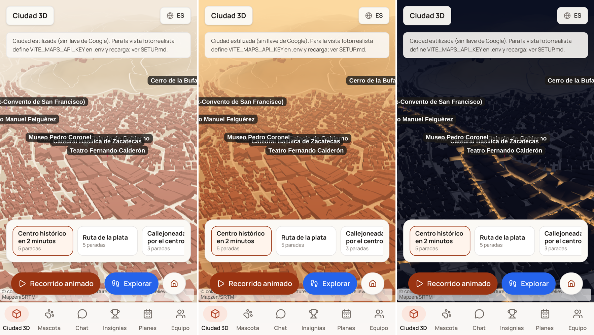
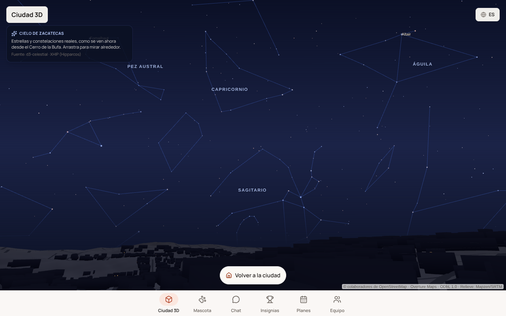

# Ciudad 3D estilo juego — arquitectura

Objetivo: un recorrido 3D animado sobre la arquitectura real de Zacatecas, con mecánicas tipo Pokémon Go (avatar, descubrir lugares, colección), donde sea fácil enchufar recomendaciones, fotos, avatares y animaciones. Web app primero (navegador móvil); app nativa después, si el demo lo justifica.

Ábrelo en `http://localhost:3000/#3d` (o con el botón **Ciudad 3D** del encabezado). Con `VITE_MAPS_API_KEY` (Maps JavaScript API) se ve fotorrealista; sin llave, estilizada.

## Capas

```
 UI (React)                 src/components/Map3DView.tsx   tarjetas, HUD, botones
   │ usa
 Contrato                   src/types/scene3d.ts           SceneEngine · SceneLayer · ScenePoi · Tour
   │ implementan
 Motor 3D                   src/scene3d/googleMaps3dEngine.ts   (mañana: cesiumEngine.ts, threeEngine.ts)
 Capas de contenido         src/scene3d/layers/*.ts        lugares, fotos, recomendaciones, retos
   │ leen
 Datos                      src/data/*.ts (mock) · /api/py/* (FastAPI, services/api)
```

- **Motor (`SceneEngine`)**: monta la escena, pinta puntos, mueve la cámara (`flyTo`, `orbit`), dibuja rutas. La UI nunca habla con Google/Cesium/Three directamente, así que cambiar de motor es escribir otra clase con la misma interfaz.
- **Capa (`SceneLayer`)**: una función `load()` que devuelve `ScenePoi[]`. Es el punto de enchufe para todo lo nuevo. Una capa puede leer `src/data/` o llamar a `/api/py/...`.
- **Recorrido (`Tour`)**: lista de paradas con cámara, pausa y subtítulo es/en. Hoy en `src/data/tours3d.ts`; luego desde `GET /api/py/tours`.

## Motor elegido para el primer mock

**Google Maps 3D** (`Map3DElement` de Maps JavaScript API, librería `maps3d`): muestra los Photorealistic 3D Tiles de la ciudad real, usa la misma llave que el mapa 2D y ya trae marcadores 3D, polilíneas, vuelos de cámara y modelos `.glb` (`Model3DElement`).

Desde #127 la vista abre por defecto en la ciudad estilizada de three.js, haya o no llave: es la vista normal, no un respaldo. Google Maps 3D se elige a mano con `?engine=google#3d` y Cesium con `?engine=cesium#3d`; las dos necesitan llave.

Límites conocidos, que abren issues:
- `Model3DElement` no reproduce animaciones glTF. Para el avatar que camina está **CesiumJS** (`src/scene3d/cesiumEngine.ts`, mismos 3D Tiles vía Map Tiles API): `?engine=cesium#3d`. Comparativa en `docs/poc/motor-3d.md`; `?stats=1` muestra tiempos y fps.
- Si Google rechaza la llave (dominio no autorizado, API sin habilitar) o no hay 3D Tiles, la vista cae sola a three.js y muestra el código de error de Google.
- Cuesta por carga de mapa y necesita red. **Sin llave** (o con `?engine=three`) entra `src/scene3d/threeOsmEngine.ts`: ciudad estilizada con three.js y 6,861 huellas reales de edificios (`public/data/centro-edificios.json`, Overture Maps 2026-10-21: OpenStreetMap + Microsoft + Google Open Buildings, ODbL). Relieve real de AWS Terrain Tiles (SRTM, cuadrícula de 10 m; `scripts/gen-terrain.py` → `public/data/centro-terreno.*`), calles de OpenStreetMap vía Overture (`public/data/centro-calles.json`) y alturas estimadas por tamaño de huella. El fondo sigue la hora de Zacatecas sin interruptor (#128): día, tarde (17:30–19:30) y noche (19:30–06:30), ventana fija `PROTO:` en `src/scene3d/timeOfDay.ts`; cambia sola al cruzar un corte. Para probar: `?hora=dia` (o `tarde`, `noche`; `?noche=1` también vale).  De noche la ciudad queda oscura y solo se alumbran las calles principales del centro (#136): la lista y su traza salen de OpenStreetMap por nombre (`scripts/gen-alumbrado.py` → `public/data/centro-alumbrado.json`); para cambiarla, edita `CALLES` en el script y vuelve a correrlo. De noche también sale el cielo real (#197): estrellas hasta magnitud 5.5 y las líneas de las constelaciones, giradas con la hora sideral de Zacatecas (`src/scene3d/starSky.ts`; datos de d3-celestial, BSD-3, estrellas de XHIP/Hipparcos: `scripts/gen-cielo.py` → `public/data/cielo.json`). «Mirar el cielo» sube la cámara al Cerro de la Bufa, mira al suroeste y deja girar la vista arrastrando; muestra los nombres de las constelaciones principales y de las estrellas más brillantes. Si no es de noche en Zacatecas (p. ej. con `?hora=noche`), enseña el cielo de hoy a las 22:00. 
- Licencia: los 3D Tiles de Google no se pueden cachear ni extraer; se muestran en vivo con atribución.

## Cómo agregar algo nuevo

**Una capa** (fotos, recomendaciones, retos):
1. Crea `src/scene3d/layers/miCapa.ts` que exporte un `SceneLayer`.
2. Devuelve `ScenePoi` con `kind` adecuado y `isMock: true` si los datos son de ejemplo.
3. Regístrala en `src/scene3d/layers/index.ts`. Con `toggleable: true` sale un interruptor en el HUD de Explorar; `load(context)` recibe la posición del jugador y los lugares visitados, y `reloadOnDiscover: true` la recarga al descubrir un lugar (así funciona `recommendationsLayer`).
4. Si los datos vienen de Python: endpoint en `services/api/` + fixture en `services/api/app/fixtures/` + contrato en `docs/API.md`.

**Un recorrido**: agrega un `Tour` en `src/data/tours3d.ts` usando `placeId` de `src/data/places.ts`. Los subtítulos deben salir de datos documentados (descripciones de `places.ts` o fuentes de la base de conocimientos), nunca inventados.

**Una temporada o fiesta** (#68): agrégala en `src/data/seasons.ts` con `provisional: true` y su fuente por confirmar. `activeSeason(fecha)` la activa; sus banderas (`night`, `petals`, `fireworks`, `papelPicado`, `legendaryDrops`) deciden qué pinta la vista: la noche y los pétalos van en el motor (`setSeason`, opcional), el papel picado y los cohetes en `src/scene3d/SeasonOverlay.tsx`. Un recorrido con `season` solo se ofrece en esa temporada. Un evento de un solo año lleva `year` y `provisional: false` con `sourceUrl` oficial (p. ej. la Carrera Panamericana del 22 de oct de 2026, datos en `src/data/panamericana.ts`). Para probar: `?temporada=muertos` (o `feria`, `panamericana`, `ninguna`).

**Un avatar**: modelo `.glb` low-poly (< 2 MB, solo PBR básico, sin extensiones glTF), con licencia libre anotada, en `public/models/avatars/`.

**Un motor**: clase nueva que implemente `SceneEngine`, elegida en `Map3DView` (p. ej. por `?engine=cesium`).

**Un monumento**: ver la sección siguiente.

## Cómo aportar un monumento

Un monumento cambia sus huellas extruidas por un modelo `.glb` cuando la cámara se acerca (#227).

- La ciudad sale primero con las huellas.
- El modelo se pide solo con el monumento en cuadro y la cámara a menos de 800 m (`MONUMENT_NEAR_M` en `src/scene3d/monuments.ts`). Mientras la cámara siga cerca, el modelo reemplaza las huellas.
- Al alejarse a más de 880 m vuelven las huellas.
- Sin `public/data/monumentos.json`, la ciudad se ve igual.

Se aporta un monumento por PR:

1. **Modélalo** en Blender u otro programa:
   - 1 unidad = 1 m, el norte hacia +Y y el piso en Z = 0;
   - el origen va donde lo pondrá `position`, por lo general el centro de su huella;
   - sin texturas: el color va en los materiales, con la paleta de la maqueta (cantera `#C98B78`, caliza `#E7DCC9`).

   Exporta glTF binario (`.glb`) con «+Y Up». La fuente de Blender no se sube: `*.blend` está en `.gitignore`.
2. **Comprímelo con Meshopt.** El motor aún no lee Draco ni texturas KTX2.
   ```bash
   npx @gltf-transform/cli optimize mi-monumento.glb public/models/monumentos/<id>.glb --compress meshopt --palette false
   ```
   Con `--palette false` los colores se quedan en los materiales en vez de pasar a una textura. `npx @gltf-transform/cli inspect <archivo>` muestra los triángulos de cada malla (columna `glPrimitives`).
3. **Revisa el presupuesto:** 300 KB y 20 mil triángulos por modelo. El mismo chequeo corre en CI y falla si un modelo se pasa.
   ```bash
   node scripts/check-monumentos.mjs
   ```
4. **Regístralo** en `public/data/monumentos.json`. Así va la Catedral de prueba:
   ```json
   {
     "id": "catedral",
     "buildingIds": [8821, 8826, 8827],
     "model": "/models/monumentos/catedral-prueba.glb",
     "position": { "lat": 22.775586, "lng": -102.572145 },
     "rotation": 22.1,
     "scale": 1,
     "license": "CC0 1.0; medidas de las huellas de Overture Maps y OpenStreetMap (ODbL 1.0)",
     "author": "Modelo de prueba de zacdeslumbrante (scripts/gen-monumento-prueba.mjs)"
   }
   ```
   - **`buildingIds`:** el lugar de cada huella que reemplaza en `buildings` de `public/data/centro-edificios.json`.
     - Para encontrarlas, `node scripts/check-monumentos.mjs --huellas <lat> <lng>` lista las huellas a menos de 80 m, de la más cercana a la más lejana.
     - Si se regenera `centro-edificios.json`, esos números cambian. El chequeo avisa si una huella queda a más de 100 m del monumento, pero una huella vecina no la nota: revisa la lista a mano.
   - **`position`:** dónde va el origen del modelo. Su base se asienta en la esquina más baja de sus huellas, como cada huella en pendiente.
   - **`rotation`:** grados en sentido horario vistos desde arriba. Con 0, el norte del modelo apunta al norte.
   - **`scale`:** 1 si el modelo está en metros.
   - **`license` y `author`:** obligatorios, con licencia libre.
5. **Pruébalo:**
   - corre `./scripts/dev.sh`, abre `http://localhost:3000/#3d` y acércate;
   - en la pestaña Red de DevTools, el `.glb`, `GLTFLoader` y el decodificador de Meshopt no aparecen hasta que te acercas.

Notas:
- Sin Git LFS mientras cada modelo respete el tope.
- La Catedral de prueba es un bloque con dos torres y una cúpula del tamaño de sus huellas. Sus alturas van a ojo (`PROTO:`), la genera `scripts/gen-monumento-prueba.mjs` y la reemplaza #228.
- `PROTO:` de noche el modelo no recibe el alumbrado de las calles que pintan las huellas; lo ilumina la luz de luna de la escena.

## Mecánicas de juego (plan)

1. Recorrido animado de cámara (hecho en el mock).
2. Avatar en la escena, movido con teclado o pad táctil (hecho: `minero.glb` generado por `scripts/gen-avatar-glb.mjs`, `useAvatarControls`; sin animación de caminar hasta decidir motor).
3. Posición por GPS, con modo simulado para probar desde casa (hecho: `usePlayerPosition`, `?sim=1#3d` lo fuerza; tocar el mapa mueve al jugador a mano).
4. Descubrir lugares al entrar en un radio de 40 m y guardarlos en una colección local (hecho: `useCollection`, `localStorage` `zacatecas_collection_v1`).
5. Retos e insignias servidos desde FastAPI.
   - Vida de calle (hecho, #40): `streetLifeLayer` pinta en rosa mexicano puestos, artesanos y la callejoneada desde `GET /api/py/street-life`. Sin `placeId`, así que en Explorar no se ponen en gris ni cuentan para la colección.
   - Puntos del centro (hecho, #295): `centroPointsLayer` pinta el catálogo de `src/data/centroPoints.ts`. Todo `ScenePoi` con `tier` se dibuja por nivel (`poiTiers.ts`, `poiMarkers.ts`): nivel 1 pin con icono y nombre siempre, nivel 2 punto con nombre al acercarse, nivel 3 punto chico solo de cerca; los que se enciman se agrupan en el de más nivel (+N).
   - Clases menores (#312): con `pointKind` el punto es puesto (cuadro verde, la vida de calle), referencia (rombo, sin nombre) o secreto (un «?» que solo sale a menos de 40 m del avatar).
   - Menos letreros (#309): máximo 5 nombres en celular, 8 en tableta y 12 en escritorio (`labelBudget` en `poiTiers.ts`). En celular sale una sola tarjeta de foto y las demás se cuentan en el chip «N fotos cerca» (`onNearbyPhotos`), que abre el visor. Los avisos (temporada, misión, ciudad estilizada) son chips del borde inferior que no vuelven tras verlos (`NoticeChips`, `zacatecas_seen_notices_v1`).
6. Desde la tarjeta de un lugar, abrir el chat RAG con ese lugar como contexto.

Detalle y orden en las épicas de GitHub: #7 (Ciudad 3D), #8 (modo juego) y #9 (contenido enchufable).

## Teleférico simulado (#263 / #264, demo)
`cableCabins.ts` usa los cables locales y `cabinConfig` de `CableCarLayer`, validados desde
`public/data/teleferico.json`. `SceneEngine.getCableCabinState?()` devuelve estado
(`unavailable`, `closed`, `running`, `reduced`), `riding` y `heightM` (null si no es válida).
`rideCableCabin?(boolean)` entra/sale de la cámara bajo el piso; salir restaura la cámara anterior.
La altura es piso menos DEM en las mismas coordenadas métricas; no es una medición en vivo.
`stop`, otros modos, cierre de horario y movimiento reducido cancelan el seguimiento.
En desarrollo `?hora=12` / `?hora=20` fuerzan horario e iluminación; producción ignora la hora numérica.
Las cabinas llevan `_mock: true`; la UI informa de la simulación y del horario pendiente de confirmar.
