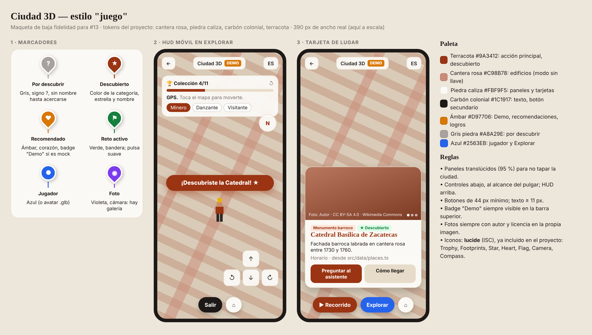

# Estilo visual de la ciudad 3D (#13)

Fuente editable: [`maqueta.html`](maqueta.html) (ábrela en el navegador; la PNG se regenera con una captura).

## Decisiones
- **Marcadores por estado**: por descubrir (gris, "?"), descubierto (color de la categoría, estrella), recomendado (ámbar, corazón), reto activo (verde, bandera), foto (violeta, cámara), jugador (azul o avatar).
- **HUD móvil**: colección y progreso arriba, junto con la fuente de posición y la elección de avatar; brújula a la derecha; pad y botones abajo, al alcance del pulgar.
- **Tarjeta de lugar**: foto con autor y licencia encima de la imagen, etiquetas de categoría y estado, texto desde `src/data/places.ts`, acciones "Preguntar al asistente" (#25) y "Cómo llegar".
- **Paleta**: los tokens del proyecto (terracota, cantera rosa, piedra caliza, carbón colonial) más ámbar para Demo y logros, gris piedra para lo no descubierto y azul para el jugador.
- **Iconos**: lucide (ISC), ya instalado.

Ya implementado en `Map3DView`: colores de descubierto y por descubrir, HUD con colección y avatar, pad y aviso al descubrir. Pendiente: iconos por estado en los motores, brújula y fotos en la tarjeta (#23).
