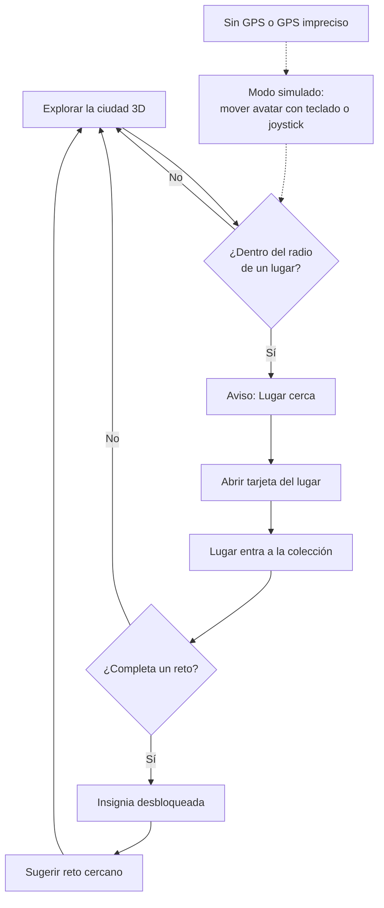

# Mecánicas del modo juego: descubrir, coleccionar e insignias

> Nivel: **boceto** (#16). Reglas para acordar antes de programar. Nada aquí es código ni promesa de producto.

## Para quién

- **Turista de un día**: llega, camina el centro unas horas y se va. Necesita sentir progreso rápido: 3 o 4 lugares deben bastar para su primera insignia.
- **Local o visitante que vuelve**: ya conoce la Catedral. Le interesa completar colecciones largas, ir a los Pueblos Mágicos y volver a lugares en días distintos.

Las dos rutas usan las mismas reglas; lo que cambia es qué insignias están a su alcance.

## Bucle de juego en 5 pasos

1. **Explorar**: el visitante camina (o mueve el avatar) por la ciudad 3D. Los lugares sin descubrir se ven como siluetas.
2. **Acercarse**: al entrar al radio de un lugar aparece el aviso "Lugar cerca".
3. **Descubrir**: toca el aviso; se abre la tarjeta del lugar (historia documentada, leyenda y recomendación práctica, igual que en el chat) y el lugar pasa a su colección.
4. **Coleccionar**: cada lugar descubierto cuenta para uno o varios retos; la barra del reto avanza.
5. **Ganar insignia**: al completar un reto se desbloquea su insignia y se sugiere el siguiente reto cercano (capa de recomendaciones, #24).

## Radio para descubrir

| Tipo de lugar | Radio | Por qué |
|---|---|---|
| Centro histórico (Catedral, Plaza de Armas, Teatro Calderón, museos) | **40 m** | Calles estrechas y lugares juntos: un radio mayor descubriría dos a la vez. |
| Lugares grandes (Cerro de la Bufa, Acueducto, Mina El Edén, Teleférico) | **120 m** | La entrada no siempre coincide con la coordenada; hay que perdonar. |
| Fuera de la capital (La Quemada, Pueblos Mágicos) | **500 m** | Basta con llegar al pueblo o a la zona arqueológica. |

Reglas de apoyo:
- Precisión del GPS peor que el radio → se pide confirmar con un toque ("¿Estás en la Catedral?") en vez de descubrir solo.
- Un lugar se descubre una vez por día. Volver otro día cuenta como **visita**, no como descubrimiento (para las insignias de regreso).

## Qué pasa sin GPS

- **Sin permiso o sin señal**: se activa el **modo simulado** (#18). El avatar se mueve con teclado o joystick y descubre igual, pero la tarjeta muestra el badge "Visita virtual".
- Las insignias ganadas en modo simulado son válidas para explorar desde casa, pero se muestran con contorno punteado. Las de visita real, sólidas. Así nadie pierde el juego por no tener GPS y no se confunde una visita virtual con una real.
- **GPS impreciso** (> 100 m): se usa la confirmación con un toque descrita arriba.

## Insignias de ejemplo

Todas usan ids de `src/data/places.ts`. Las ocho primeras coinciden con el fixture de `GET /api/py/challenges` (#21).

| Insignia | Reto | Lugares | Para |
|---|---|---|---|
| Cantera Rosa | Corazón de cantera | `catedral-zacatecas`, `plaza-armas`, `teatro-calderon` | Turista de un día |
| Vista de Águila | Cumbre de La Bufa | `cerro-de-la-bufa`, `teleferico-zacatecas` | Turista de un día |
| Minero de Plata | Bajo tierra | `mina-el-eden` | Turista de un día |
| Curador | Ruta de museos | `museo-rafael-coronel`, `museo-pedro-coronel`, `museo-felguerez`, `museo-francisco-goitia` | Ambos |
| Acueducto | Agua y piedra | `acueducto-el-cubo` | Turista de un día |
| Arqueólogo | Huellas antiguas | `la-quemada` | Quien vuelve |
| Viajero Mágico | Pueblos Mágicos | `jerez-pueblo-magico`, `sombrerete-pueblo-magico`, `guadalupe-pueblo-magico`, `pinos-pueblo-magico` | Quien vuelve |
| Virreinal | Guadalupe virreinal | `guadalupe-pueblo-magico`, `catedral-zacatecas` | Ambos |
| Cronista | Toda la capital | los 11 lugares de la capital (centro, Bufa, mina, teleférico, museos, acueducto) | Quien vuelve |
| De Regreso | Volver | cualquier lugar visitado en 3 días distintos | Local |
| Las cuatro estaciones | Volver por temporada | `plaza-armas` en 4 meses distintos | Local |

## Lo que no entra (y por qué)

- **Sin dinero ni descuentos reales**: ninguna insignia da premios, cupones ni precios. Si algún día hay alianzas con comercios locales, será un acuerdo aparte y se marca como *futuro*.
- **Sin datos personales**: la colección vive en el dispositivo (`localStorage`). Nada de cuentas, correos ni historial de ubicación en un servidor.
- **Sin rankings públicos**: comparar visitantes empuja a correr entre lugares en vez de conocerlos. *Futuro*: rankings opcionales entre amigos.

## Preguntas abiertas

- ¿El modo simulado debe poder descubrir lugares fuera de la capital, o solo el centro?
- ¿Mostramos las siluetas de lugares no descubiertos o los dejamos ocultos hasta acercarse?
