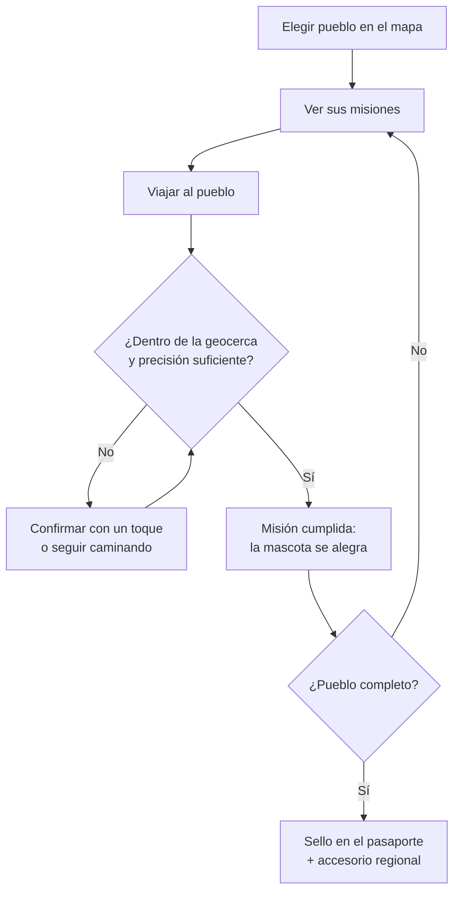

# Pueblos Mágicos con misiones presenciales

> Nivel: **boceto**. Idea a futuro para acordar antes de programar. Nada aquí es código ni promesa de producto.

## La idea en un minuto

La mascota (pantalla **Mascota**, ver `src/pet/`) hoy se saca a pasear por el centro de Zacatecas en la Ciudad 3D. El siguiente paso es llevarla **fuera**: primero a los Pueblos Mágicos de Zacatecas (Jerez, Sombrerete, Guadalupe, Pinos, que ya están en `src/data/places.ts`) y después a Pueblos Mágicos de otros estados. Ahí las misiones se cumplen **estando en el lugar**, con la ubicación del teléfono, y cada pueblo deja un sello en un **pasaporte**.

## Para quién

- **Viajero de fin de semana**: va a un pueblo cercano y quiere algo que hacer ahí. Le basta con llegar y visitar 2 o 3 puntos.
- **Coleccionista**: quiere completar estados enteros. Para él son los sellos y los accesorios de la mascota.

## Bucle



## Tipos de misión

| Tipo | Qué pide | Radio | Ejemplo |
|---|---|---|---|
| Llegar | Entrar a la geocerca del pueblo | 500 m | "Llega a Jerez" |
| Parada | Estar junto a un lugar del pueblo | 40–120 m (como `mecanicas.md`) | "Visita el Teatro Hinojosa" |
| Colección | N paradas del mismo pueblo | según cada parada | "3 lugares de Sombrerete" |
| Temporada | Una parada en una fecha o mes | según la parada | "Feria de primavera" |

Los radios siguen `docs/design/mecanicas.md`. El paseo de la mascota ya usa el mismo registro de visitas (`recordPlaceVisit`), así que una misión presencial es una visita con una marca extra de "verificada en sitio".

## Cómo se verifica que estás ahí

- **En el dispositivo**: Geolocation API (`watchPosition`) solo mientras la misión está abierta. Se compara la posición con la geocerca en el teléfono; el historial de ubicaciones **no** sale del dispositivo.
- **Precisión**: si la precisión reportada es peor que el radio, se pide confirmar con un toque y la misión queda como "por confirmar" (no da sello sólido).
- **Saltos imposibles**: lecturas que implican más de 200 km/h entre sí se descartan. En web no se puede detectar una ubicación falsa del sistema; se acepta ese límite en esta etapa.
- **Sin GPS**: se puede jugar en modo simulado, pero la insignia se muestra con contorno punteado (regla de `mecanicas.md`). El sello del pasaporte solo se da con visita real.
- **Al servidor solo va** `{ missionId, placeId, verifiedAt, accuracyM }`, nunca la ruta.

## Cuentas y guardado

Los sellos y misiones se guardan con la interfaz `ProgressStore` (`src/progress/progressStore.ts`), igual que la mascota. Las misiones presenciales **requieren cuenta** (Google o usuario y contraseña, hilo de cuentas) para no perder sellos al cambiar de teléfono. Se añade una clave `passport` al contrato `GET/PUT /api/py/me/progress`.

## Datos

- Fuente de la lista de pueblos: el catálogo oficial de Pueblos Mágicos de la Secretaría de Turismo federal. Se cita la fuente en cada ficha; nada de horarios, precios ni comercios inventados.
- Modelo propuesto (mock en `services/api/app/fixtures/towns.json`):

```json
{
  "_mock": true,
  "towns": [
    {
      "id": "jerez",
      "state": "zacatecas",
      "name": { "es": "Jerez de García Salinas", "en": "Jerez de García Salinas" },
      "center": { "lat": 22.6478, "lng": -102.9906 },
      "radiusM": 500,
      "placeIds": ["jerez-pueblo-magico"],
      "missions": [{ "id": "jerez-llegar", "kind": "arrive", "title": { "es": "Llega a Jerez", "en": "Reach Jerez" } }]
    }
  ]
}
```

- API (mock): `GET /api/py/towns?state=zacatecas`, `GET /api/py/towns/{id}`.

## La mascota fuera de casa

- Cada estado da un **accesorio** cosmético (sombrero, rebozo, paliacate…) al completar su primer pueblo. Sin compras ni ventajas de juego.
- La energía se recupera más rápido de viaje (el pueblo "la cansa menos") para que un día de visita alcance.

## Fuera de alcance (y por qué)

- Rankings públicos, premios o descuentos reales: igual que en `mecanicas.md`.
- Seguimiento en segundo plano: solo se lee la ubicación con la app abierta y una misión activa.
- Pueblos de todos los estados de golpe: se empieza con Zacatecas y un estado vecino para probar.

## Fases (issues)

1. **[sketch]** Catálogo y modelo de datos de Pueblos Mágicos (fuentes, campos, 2 estados).
2. **[mock]** `GET /api/py/towns` con datos de ejemplo de Zacatecas y un estado vecino.
3. **[mock]** Pantalla Pasaporte con sellos y misiones por pueblo.
4. **[poc]** Verificación presencial por geocerca: precisión, batería y falsos positivos con números.
5. **[demo]** Misión presencial de punta a punta con cuenta iniciada y la mascota.
6. **[sketch]** Accesorios regionales de la mascota por estado.

## Preguntas abiertas

- ¿Qué estado vecino se prueba primero (Aguascalientes, Jalisco, San Luis Potosí, Durango)?
- ¿Las misiones presenciales cuentan también para las insignias actuales o solo para el pasaporte?
