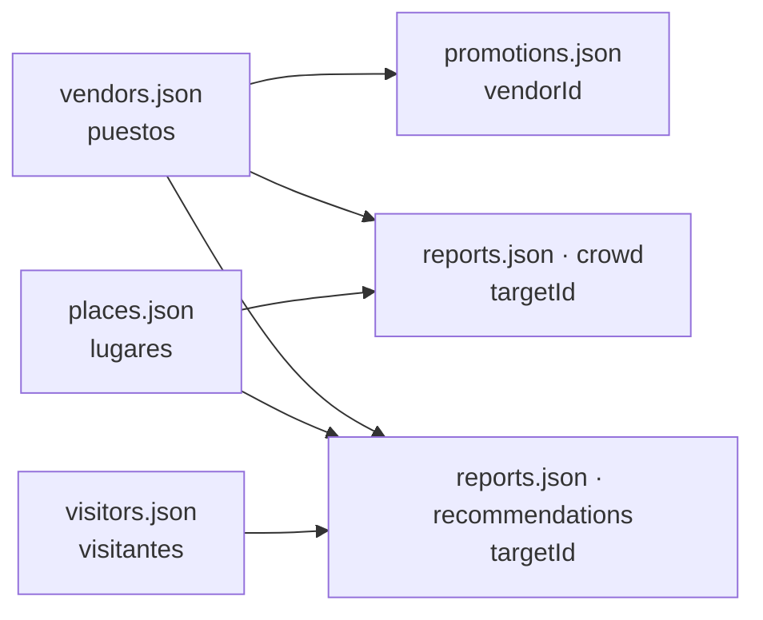

# Fixtures

Datos fijos de la API Python (nivel mock). Todo lo sintético lleva `"_mock": true` y nunca se presenta como real.

## Mundo de prueba del Centro Histórico (#170)

Sirve para probar el agente (#165), el compañero y el simulador (#175) sin estar en Zacatecas. Las reglas de cómo pesan las señales están en `docs/design/señales-del-agente.md` (#166).

- **`vendors.json`:** 20 puestos y comercios inventados: gorditas, asado de boda, dulces, café, jugos, artesanías…
  - Cada punto está sobre una calle con nombre del centro, tomada de OpenStreetMap (`public/data/centro-alumbrado.json`), y su campo `street` dice cuál.
  - Llevan horario, rango de precio (`$` a `$$$`, sin montos) e `interests` para cruzar con los visitantes.
  - Los nombres se ven ficticios a propósito («Gorditas La Imaginaria», «Café Ejemplo de Tacuba»).
- **`promotions.json`:** promociones ligadas a un puesto (`vendorId`), con inicio y fin en hora de Zacatecas (-06:00).
  - Son información, no cupones.
  - Una ya terminó, para probar que no se muestra.
- **`visitors.json`:** 10 visitantes ficticios con intereses, movilidad, presupuesto y tamaño del grupo, para los escenarios del simulador.
- **`reports.json`:**
  - `crowd`: afluencia y espera por franja horaria de cada puesto, más la Catedral y la Plaza de Armas. Son patrones (`kind: "pattern"`): el agente los dice como «suele». La comida se llena a mediodía; el café, al atardecer.
  - `recommendations`: el motivo corto de un visitante (`visitorId`) para un puesto o lugar (`targetId`), con fecha. No hay calificaciones ni estrellas. Una tiene más de 90 días, para probar que ya no cuenta.

`tests/test_world_fixtures.py` valida los cuatro archivos contra `app/models/world.py`. También revisa:
- que los nombres se vean inventados;
- que los puntos caigan sobre su calle;
- que las referencias existan y las franjas no se encimen.
